  

  

  
  
  
  

---

## 👨‍💻 Sobre mim

- 🎓 Cursando **Engenharia de Computação** na PUC Goiás
- 💼 Estagiário de análise e suporte de TI
- 🔐 Interessado em **segurança da informação**
- 🎮 Criando o **AE:MP**, um multiplayer de GTA San Andreas feito do zero
- 📍 Goiânia, Brasil

---

## 🎮 Projeto em destaque: AE:MP

<table>
  <tr>
    <td width="60%" valign="top">
      <h3>Andreas Engine Multiplayer</h3>
      

        Multiplayer de <b>GTA San Andreas</b> escrito do zero em <b>C++</b>,
        compatível com os gamemodes em <b>Pawn</b> do SA-MP.
      

      <ul>
        <li>🧩 Roda gamemodes do SA-MP sem adaptação</li>
        <li>🗄️ MySQL embutido com a API do R41, sem plugin</li>
        <li>🛡️ Anticheat próprio</li>
        <li>🖥️ Servidor para Windows e Linux</li>
        <li>🤖 Bot próprio no Discord da comunidade</li>
      </ul>
      

        
        
        
      

      

        <a href="https://github.com/SavioReis/AE-MP/releases/latest"><b>📥 Baixar</b></a> ·
        <a href="https://aemp.pages.dev"><b>📖 Documentação</b></a> ·
        <a href="https://discord.gg/ucU6C3jmNh"><b>💬 Comunidade</b></a>
      

    </td>
    <td width="40%" align="center" valign="middle">
      
    </td>
  </tr>
</table>

---

## 🚀 Tecnologias

  &nbsp;&nbsp;
  &nbsp;&nbsp;
  &nbsp;&nbsp;
  &nbsp;&nbsp;
  &nbsp;&nbsp;
  &nbsp;&nbsp;
  &nbsp;&nbsp;
  

  🌱 <b>Estudando agora:</b>&nbsp;
  
  <b>Java</b>, para aplicações robustas e escaláveis

---

## 🛠️ Ferramentas

<table align="center">
  <tr>
    <th>IDE favorita</th>
    <th>Sistemas operacionais</th>
  </tr>
  <tr>
    <td align="center">
      
    </td>
    <td align="center">
      
      
    </td>
  </tr>
</table>

---

## 📊 Estatísticas

  
  

  

  

  

